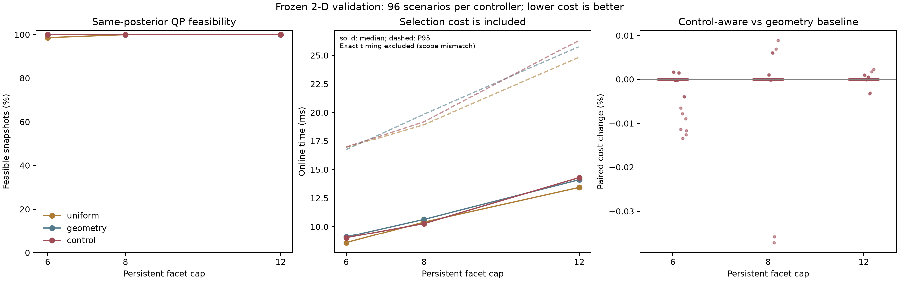

# 方案一首轮验证：当前压缩原型未通过定题门槛

报告日期：2026-11-05。冻结计划日期：2026-11-04。

**结论：当前“控制约束残差贪心选方向 + 有限面数外包 + 旧计划备份”版本，不建议直接作为硕士论文第一项创新。** 它在测试中保持了安全，支持查询数量也较少，但没有显示优于同面数几何贪心的明确闭环收益或计算优势。现有证明使用标准包含、鲁棒约束和备份论证；文献差异尚不足以支持新的贡献主张。

这个结论针对本轮具体构造，不是否定所有控制相关信息压缩方法。C→C/A 大方向保留为待重新定义的问题；原先“优先验证”的推荐不能升级为“已经可以定题”。D 路线尚未经过同等验证，也不能由本轮负结果直接推定为最优。

## 1. 已完成的工作及证据边界

沿用[冻结计划](CONG_MPC_VALIDATION_PLAN.md)，运行[新增脚本](../../../experiments/cong_mpc_validate.py)，再由[独立后处理](../../../experiments/cong_mpc_validation_audit.py)核对结果。主实验成功完成一次，耗时 516.9 秒；后续统计没有重跑控制轨迹。

| 项目 | 实际完成 |
|---|---|
| 模型 | 两个二维、已知、稳定 LTI 系统，预测长度分别为 6 和 10 |
| 初值 | 每个模型 4 个集合旋转角 × 4 条中心射线；中心取该精确先验可行边界的 98% |
| 观测 | 每拍、每 3 拍、完全无新观测；带界量测误差 |
| 预算与方法 | 6、8、12 面；均匀模板、几何贪心、控制残差贪心 |
| 强参考 | 固定完整预测方向模板（42/66 个方向）；全历史精确多边形后验 |
| 闭环 | 96 个共同场景 × 11 种控制器配置 = 1,056 条轨迹，各 30 步，共 31,680 步 |
| 同后验对照 | 精确参考的前 3 个更新时刻，共 288 个后验，每个比较 9 种压缩，共 2,592 次 |
| 独立核验 | 24 组、240 个方向，核对多边形顶点支持、半空间 LP 支持与全历史 CZ 支持 |
| 正确性测试 | 3 项通过：独立 LP 几何核验、所有压缩更新失效时的备份、条件化信息损失反例 |

96 个场景是确定性网格和固定种子的组合，不是 1,056 个独立随机样本。没有将控制步数当作统计独立样本，没有据此计算发表概率或总体显著性。

本轮约束的是**持久集合表示的面数上限**，不等于相同 CPU 时间、相同字节数或硬实时截止时间。几何贪心查询全部候选方向，控制贪心仅查询选中的方向；两者的方向选择开销均计入。临时多边形运算使用更多顶点，另行记录。

CSV 的 working_vertices 统计关键多边形的顶点数，不包含凸包前的全部候选点、求解器工作区或所有临时数组，因此不能作为峰值内存的测量。

## 2. 最有决策价值的实验结果

### 2.1 相同后验：控制相关选择没有超过几何强基线

每格分母均为 288。这里“移位可行”是上一份计划移位后仍满足约束；“QP 可行”允许重新优化找到另一份计划。

| 面数上限 | 方法 | 移位可行 | 压缩后 QP 可行 |
|---:|---|---:|---:|
| 6 | 均匀 | 268/288 | 284/288 |
| 6 | 几何贪心 | 288/288 | 288/288 |
| 6 | 控制贪心 | 288/288 | 288/288 |
| 8 | 均匀 / 几何 / 控制 | 均为 288/288 | 均为 288/288 |
| 12 | 均匀 / 几何 / 控制 | 均为 288/288 | 均为 288/288 |

控制贪心优于 6 面均匀模板的这一结果，几何贪心同样能够取得。不能仅与均匀模板比较后，把收益归因于控制相关性。

控制贪心并不追求所有方向都更紧。其最大候选方向间隙约 0.28963，在三个预算下都存在；几何贪心对应最大间隙约为 0.04845、0.01610、0.00288。这说明“当前计划可行”和“整体集合紧致”不同，但这一机制区分本身尚不构成新贡献。

### 2.2 闭环：相对几何贪心的差别很小，且并非一致更好

以下变化定义为 \(100(J_{\rm control}/J_{\rm geometry}-1)\%\)，负数为控制贪心较好。每行 96 对场景。

| 面数上限 | 最好变化 | 中位变化 | 最差变化 | 控制较好 / 较差 / 近似相同 |
|---:|---:|---:|---:|---:|
| 6 | −0.01342% | 0% | +0.00167% | 13 / 4 / 79 |
| 8 | −0.03717% | 0% | +0.00888% | 4 / 6 / 86 |
| 12 | −0.00326% | 0% | +0.00224% | 4 / 6 / 86 |

“近似相同”采用相对变化绝对值不超过 \(10^{-6}\) 个百分点的数值归类，不代表统计等效检验。原始配对值保存在 audit.json。

全部轨迹完成；控制贪心和几何贪心各预算均无备份触发。6 面均匀方法有 12 次移位失效，其中 4 次压缩 QP 不可行，依靠备份完成执行；其余均匀预算无备份。这 4 次均来自 slow 系统、45° 初始集合、90°/270° 中心射线、每 3 拍或零观测设置。

在 \(2\times10^{-6}\) 容差下，状态、输入及真值包含检查无失败。实际最大状态残差为 −0.02985，最大输入残差为 \(1.25\times10^{-8}\)。这些是浮点检查；没有证明实际系统的硬安全，也没有建立向外舍入证书。

全历史精确后验已作为闭环参考实现。其最大持久面数达到 122；有限面数方法的存储上限得到检查。有限表示确实控制了增长，但其他普通压缩基线也有这一性质。

### 2.3 查询数量减少，没有转换为本例明确的耗时优势

不含共享启动步，单位 ms；表中为中位数 / P95。

| 面数上限 | 均匀 | 几何贪心 | 控制贪心 |
|---:|---:|---:|---:|
| 6 | 8.59 / 16.94 | 9.09 / 16.74 | 9.02 / 16.96 |
| 8 | 10.40 / 18.94 | 10.64 / 19.86 | 10.27 / 19.20 |
| 12 | 13.44 / 24.84 | 14.11 / 25.77 | 14.30 / 26.34 |

控制贪心每次查询 6/8/12 个后验支持值，几何贪心查询 42 或 66 个。二维顶点支持可以批量计算，查询数量差别未形成稳定的运行时间优势。高维 CZ 中单次支持查询可能更昂贵，但本轮没有验证这个推断，也没有复现 SPIN-SMF 的求解速度。

计时包括有限面数方法的预测、当前量测条件化、方向选择、外包构造、计划残差计算与 QP；不含共同名义观测器更新、事后审计和仿真真值推进。单次运行不能视为最坏执行时间。

**计时审计发现的限制：** exact 参考把集合预测放在记录区间之外。因此，不能用 CSV 中 exact 的 online_ms 与压缩方法比较端到端速度。本报告排除了这个速度比较，没有为了计时重跑已完成实验。

## 3. 数学上验证了什么

### 3.1 任意选方向仍可保持包含

对当前非空紧集 \(S\)，所选方向 \(q_i\) 使用其支持值构造

\[
P=\{x:q_i^\top x\le h_S(q_i),\ i=1,\ldots,m\}.
\]

只要方向使 \(P\) 有界，就有 \(S\subseteq P\)。均匀模板使用正包围方向；两种贪心从坐标盒开始。选择依据可以不同，这一包含结论不变。实际代码通过浮点凸包和半平面裁剪实现。

### 3.2 备份保证的是持续可执行，不是每次压缩 QP 都可行

在接纳时刻 \(\tau\)，保存外包 \(P_\tau\) 和对全部相容状态、扰动可行的共同输入序列。第 \(j\) 步的旧计划可达集为

\[
T_j=A^jP_\tau\oplus
\sum_{i=0}^{j-1}A^{j-1-i}Bu_{\tau+i}
\bigoplus_{\ell=0}^{j-1}A^\ell W.
\]

有效当前量测与 \(T_j\) 的交集仍包含真值。若新外包上的 MPC 可行，就接纳新集合与新计划；否则继续旧计划的剩余输入。到旧终端时刻，真实状态进入 \(X_f\)，同一个终端输入 0 满足
\(AX_f\oplus W\subseteq X_f\)，因此可以继续执行并以 \(X_f\) 重置。

该归纳依赖初始计划可行、集合包含、模型与噪声界成立、共同输入和已验证终端不变性。它允许压缩 QP 暂时不可行，也允许备份期间丢弃未接纳的历史观测。保存量由最近接纳的集合、计划、输入平移和年龄组成，没有依赖隐藏的全历史精确估计器。

这是标准的已可行计划备份思路在当前集合接口上的实现，**不单独认定为新的递归可行性定理，也不推出名义二次代价下降或一般输出反馈稳定性。**

### 3.3 固定预算不能无条件保留所有可行状态集合

一个解析边界例子：取 \(x_{k+1}=x_k\)、无扰动、唯一输入 0，约束集和终端集都是具有 8 个不可冗余面的二维八边形 \(X\)，初始信息集 \(S=X\)。原问题可行。

若要求外包 \(P\supseteq S\) 保持该问题可行，则必须 \(P\subseteq X\)，因此 \(P=X\)。一个最多 6 面的二维多边形不能等于这个八边形。故不存在对任意这类输入都有效的“6 面外包且无损保留可行性”保证。

这个标准几何反例只限定普遍主张，不排除有正约束裕度、允许更大预算、其他表示或允许备份时的方法。要形成有价值的新理论，需要给出实际可构造的适用条件或非平凡预算界；把检查不等式重述为定理仍不够。

## 4. 近邻文献对照

本轮定向核对并结合已读材料形成下表。读取范围与缺口见[来源记录](../../literature/sources/cong_mpc_validation_20261105/source_notes.json)。没有复现这些论文的完整算法，不把本文几何贪心标成 CCTMPC、SPIN 或 PZR 的复现。

| 工作与读取层级 | 已有内容 | 本轮原型的差别与未完成部分 |
|---|---|---|
| Brunner、Müller、Allgöwer，2018，*Enhancing Output-Feedback MPC With Set-Valued Moving Horizon Estimation*；作者机构摘要 | 带噪部分观测，按预测位置使用不同历史量测数量，有限复杂度和递归可行 | 本轮调整状态信息外包方向；但该论文全文仍未取得，无法完成定理逐条排重，创新性门槛保持未通过。[机构记录](https://research.uni-hannover.de/en/publications/enhancing-output-feedback-mpc-with-set-valued-moving-horizon-esti/) |
| Qin、Cong、Wang、Liu，2026，*A Fast and Accurate Linear Constrained Zonotopic Set-membership Filter*；本地作者接收稿，§III–IV，命题 1、定理 1–2、算法 1–3 | 利用结构不变性、参数相似性、预计算和热启动求区间外包；算法已有最大迭代数及残差停止条件 | 本轮优化有限方向选择与控制计划的可行性，未实现其快速求解器。因此“有限迭代”“热启动”“快速 CZ”不能作为新增贡献。[DOI](https://doi.org/10.1109/TAC.2026.3712691) |
| Badalamenti 等，2025，*Efficient Configuration-Constrained Tube MPC via Variables Restriction and Template Selection*；§2–4、命题 2–3、算法 1 | 对 Tube 参数与顶点控制进行限制，细化模板，分析递归可行、稳定性和细化指标 | 原文优化以当前状态为参数的控制 Tube，本轮压缩量测相容的信息集，对象确有差别；但仅改选方向评分不足以建立新颖性。[作者稿](https://arxiv.org/html/2505.14440v1) |
| Krsmanović、Kohn、Finkbeiner、Simović，2026，*Predictive Zonotope Reduction: Precise Runtime Monitoring under Uncertainty*；§II–III | 将运行监测的降阶算子选择作为序贯决策，使用预测搜索，保留各降阶算子的外包可靠性 | 本轮关注物理输入的鲁棒可行性，未进行未来降阶序列优化；“动态选择压缩”“预测降阶”本身已有。[作者稿](https://arxiv.org/html/2609.03699v1) |
| Scokaert、Mayne、Rawlings，1999，*Suboptimal Model Predictive Control (Feasibility Implies Stability)*；检索到的 IEEE 摘要与机构索引 | 在相应条件下研究由初始可行解出发的次优 MPC 与稳定性 | 仅作为“可行解与受限计算并非新问题”的背景；本文未逐条读取其全文，不直接借用该文的稳定性定理。[DOI](https://doi.org/10.1109/9.751369) |

SPIN 的残差停止条件与最大迭代数，不能自动等同于本课题要求的支持函数上界证书；反过来，“加一个 maxiter”也不能成为区别。若后续走计算预算路线，需要同时解决有效上界、预算分配、结构复用和控制后果，并与其实际实现比较。

**本轮没有证明“与已有工作完全重复”，也没有证明“尚无已有工作解决”。** 目前最明确的问题是：当前构造的实证优势不足，新的理论贡献尚未形成，而最接近的 Brunner 全文对照仍有缺口。

## 5. 第二点：观测资源调度是否有必要

完全不接收新观测时，所有本轮控制器仍完成了安全执行。因此，当前稳定系统和终端设计不支持“主动采样对维持安全必不可少”的论证。

观测对性能仍有作用。使用全历史精确参考，零观测相对每拍观测的代价增加中位数在 fast / slow 系统分别为 0.245% / 1.624%；每 3 拍观测分别为 0.107% / 0.145%。个别初值的相对增幅较大，原始分布已保留；不同初值代价基数不同，不能用最大相对增幅代表通常收益。

这只说明资源—性能权衡有研究动机。还没有观测调度算法，没有相同采样配额下优于周期采样的证据，也没有所有未来相容量测分支下的资源可行性证明。不能将本轮结果写成第二项创新已经成立。

## 6. 定题决定与下一步的具体门槛

| 门槛 | 当前判断 |
|---|---|
| 小规模数值正确性与备份实现 | 通过本轮检查，适用范围限定为所列模型与数值容差 |
| 同面数强基线下的控制收益 | 当前原型未显示有意义的一致优势 |
| 相同计算预算下的优势 | 尚未验证；本轮是表示预算，不是硬计算预算 |
| 新的控制理论贡献 | 未形成；现有包含与备份论证属标准结构 |
| 全文级创新性排查 | 未完成，Brunner 全文仍是关键缺口 |
| 第二项调度贡献 | 未完成 |

按研究方案评价框架，对**当前贪心原型作为独立创新点**的决定是 **Reject and Pivot**。这不等于对整个“资源约束集员输出反馈 MPC”方向作永久否定。

后续应先选择一个明确的新问题再投入完整论文工作：例如，高维 CZ 下确有支持求解瓶颈时的预算分配及可验证误差界；或者当前支持值保持仍会损失未来量测价值时的可控压缩损失。它们目前只是待验证问题，不能在本轮负结果之后自动当作已成立的替代创新。

不建议继续以修改噪声种子、只和盒或 6 面均匀模板比较、增加无人机展示来挽救当前版本。若要转向 D，应另做连续多假设集合的安全与消歧验证，沿用相同的强基线和负例要求。

## 7. 复现、审计与已知限制

- [summary.json](../../../experiments/results/cong_mpc_validation/summary.json)：环境、模型、4 个源文件和 4 个输入结果文件的 SHA-256。
- [audit.json](../../../experiments/results/cong_mpc_validation/audit.json)：8 个哈希核对、逐场景配对、预算检查及计时限制。
- [cases.csv](../../../experiments/results/cong_mpc_validation/cases.csv)、[steps.csv](../../../experiments/results/cong_mpc_validation/steps.csv)、[static.csv](../../../experiments/results/cong_mpc_validation/static.csv)：全部案例、控制步和静态对照。
- [independent_audit.json](../../../experiments/results/cong_mpc_validation/independent_audit.json)：240 个独立支持核对的最大差异为 \(2.37\times10^{-7}\)，低于约定容差。
- [对比图 PDF](../../../experiments/results/cong_mpc_validation/validation_evidence.pdf)。

已有结果存在时，主脚本拒绝覆盖。只重新核对和生成统计，可运行：

~~~powershell
& .venv/Scripts/python.exe -m experiments.cong_mpc_validation_audit
~~~

本轮新增实现曾在主实验开始前发现并修复 CSV 写入处的换行转义语法错误；随后 3 项正确性测试通过。恢复工作时先检查了进程与结果目录，确认没有完成结果后启动了带日志的主运行；成功后未再次执行控制仿真。日期字段 summary.date 沿用了冻结计划的 2026-11-04，实际完成日期为 2026-11-05，已在后处理记录中注明，未改写冻结数据。

模型仍为二维稳定系统，压力主要来自初始边界，后续许多控制约束不活跃；结果不能外推到高维、非线性、未知参数或不稳定系统。没有运行 PX4/Gazebo 或实飞，没有修改 src 的控制算法，也没有覆盖先前 screen/audit 或飞行实验结果。
