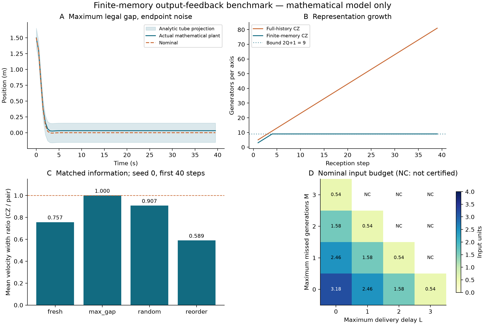

# 课题方案：间歇与延迟位置量测下四旋翼外环的有限记忆集员估计与鲁棒预测控制

**版本：2026-11-04，可用于开题讨论的完整方案。** 已有可运行的抽象六状态闭环与条件证明；尚未完成真实飞控模型覆盖、SITL/HIL 或实飞。本文中的“已完成”仅指明确列出的数学模型和实验。创新性仍需针对最近文献逐条比对，不能据此保证论文录用。

**评价目标澄清（2026-11-04）：** 本课题结合方案的主要目标是提高抗扰性能。主要指标为可认证扰动范围、鲁棒约束满足、可行初始域、失测/延迟容忍域及扰动后恢复；跟踪RMSE仅作辅助。新增验证见[抗扰预登记](ROBUSTNESS_PLAN.md)与[抗扰结果](ROBUSTNESS_RESULTS.md)。此前跟踪改善小的观察，不能单独用于否定抗扰收益。

**SITL初测更新：** 同日按用户要求运行4次正式PX4/Gazebo接入，原算法未调参。连续测量出现空后验，失测组出现速度越界；已接入但未通过，数学合同尚未覆盖物理执行链。详见[实测结果及ULog](../../simulation/CZ_SITL_RESULTS.md)。

## 1. 选题结论

建议保留“四旋翼外环、位置-only、有界扰动、间歇/迟到量测”的应用目标，将研究核心收敛为：

> 在只使用已交付时间戳信息的条件下，如何限制集员估计的记忆与计算规模，同时把可证明的状态误差界接入递归可行的输出反馈 MPC；进一步，何时保留集合相关性与测量模式信息能够带来实际控制收益？

建议论文题目：

**《间歇位置量测下四旋翼外环的有限记忆集员估计与信息模式感知鲁棒模型预测控制》**

英文候选：*Finite-Memory Set-Membership Estimation and Information-Pattern-Aware Robust MPC for Quadrotor Outer-Loop Control with Intermittent Position Measurements*。

硕士课题的最低完成边界是“可靠估计—因果控制—终端可行—抽象闭环—高保真对照”的完整链条。相位相关优化是性能贡献，不能成为无限推迟可运行基线的理由。

## 2. 为什么值得做，以及已经有人做了什么

三个方向各自已有成熟工作：CZ 集合运算和有界估计；丢包/延迟下的误差恢复；输出反馈 Tube MPC 的收紧和递归可行性。问题在于连接这些部分时，常被忽略的时间戳、启动期、集合代表点、历史相关性和计算规模会破坏保证。上一轮本地固定滞后 CZ 已证明，状态窗口固定并不会自动使生成元数量固定；一步安全门也可能在下一拍无解。

| 原始工作 | 对本题的直接限制 | 本轮证据等级 |
|---|---|---|
| [Scott et al., 2016](https://doi.org/10.1016/j.automatica.2016.02.036) | CZ 运算及降阶已经存在，不能把“使用 CZ”当作创新 | 作者稿 Proposition 1、§5 定向正文核验 |
| [Rego et al., 2020](https://doi.org/10.1016/j.automatica.2019.108614) | 非线性有界估计及外包已有先例；局部线性化不等于可靠预测 | 本轮核对作者摘要，既有阅读记录保留 |
| [Hassaan et al., 2021](https://doi.org/10.1016/j.ifacol.2021.08.482) | 有限语言、Equalized Recovery、时变 Tube 与递归可行不是空白 | 作者稿 §3、Assumptions 1–3、Theorems 5–7 定向核验 |
| [Ji et al., CDC 2022](https://doi.org/10.1109/CDC51059.2022.9992704) | SMF 与 Tube MPC 已结合，并有12状态四旋翼算例 | 作者稿 §II、§III-A、§V-B；其四旋翼算例取 \(C=I\)，非位置-only |
| [Andrade et al., 2024](https://doi.org/10.1109/ACCESS.2024.3381622) | 已有直接以 CZ 为基础的 Tube MPC 论文 | Crossref 书目与作者学校论文目录核验；独立论文正文未取得 |
| [Robbins et al., ACC 2026](https://pure.psu.edu/en/publications/online-constraint-tightening-for-mpc-using-constrained-zonotope-r/) | 在线 CZ 可达集收紧、CZ 到 zonotope 外包已有直接竞争工作 | 作者单位摘要核验；全文未取得 |
| [Krsmanovic et al., 2026](https://arxiv.org/abs/2609.03699) | 不确定性集合增长与在线降阶也是活跃方向 | 预印本摘要，非控制递归可行性证据 |
| [Baranowski, 2026](https://arxiv.org/abs/2610.26326) | “两次量测可观测”与“达到最小最坏误差”不是同一问题 | 预印本摘要；未同行评审完成，不移植其定理 |

**不能主张：** 首次 SMF＋MPC、首次 CZ Tube MPC、首次有限长度丢包恢复、首次四旋翼输出反馈 MPC，或两次位置量测对所有噪声模型都最优。

**可检验的贡献候选：** 时间戳正确的有限记忆外包及显式资源上界；从启动到恢复的完整控制准入；在不泄露未来交付信息的条件下，把有限信息模式转成可移位的收紧序列；量化“估计集合更紧却未改善控制”的边界。是否具有可发表的新颖性，取决于与上述近邻工作的全文逐项比较。

## 3. 研究问题与可否证假设

**RQ1：** 有最大未生成长度 \(M\) 和最大交付延迟 \(L\) 时，能否在固定记忆内保持真实位置—速度状态包含，并给出与运行时长无关的误差和表示规模上界？

**H1：** 对冻结的 ZOH 双积分抽象模型，窗口 \(Q=2M+L+1\) 足够，每轴最多 \(2Q+1\) 个生成元、\(Q-1\) 条等式。已有解析证明和代码验证。推广到一般外环模型是另一个命题。

**RQ2：** 上述估计能否从初始化开始接入因果共同输入控制，并获得非空终端集合、硬约束和递归可行性？

**H2：** 初始不确定度满足 Tube 准入且名义初始优化可行时，统一误差管基线可实现。已有显式构造、精确代数证书和闭环验证；不等于任意初值都可行。

**RQ3：** 在相同状态/输入约束、噪声/交付条件和计算预算下，保留CZ相关性、利用已观察信息模式，能否扩大可认证扰动范围、鲁棒初始可行域或失测/延迟容忍域，并改善扰动后恢复？

**H3：** 通过可证明的模式相关误差管与收紧，可能在共同约束下改善抗扰预算。当前CZ与pair共享统一Tube，因此可认证扰动边界相同；新增合同内及超界压力测试尚未显示CZ的额外抗扰优势。此结果限定于当前构造，不能推广成结合方案无价值。下一阶段必须按事前固定的抗扰指标公平比较，保留无收益及失败结果。

## 4. 模型层次与物理边界

| 层次 | 用途 | 当前状态 |
|---|---|---|
| 三轴 ZOH 双积分器，6状态 | 理论和算法单元基线；明确量词、误差与终端 | 已实现、已运行 |
| 一般线性/增广外环闭环模型 | 表达成熟飞控跟踪、指令保持或延迟 | 待辨识和验证 |
| 12状态六自由度刚体＋成熟姿态/角速度内环 | 测试抽象模型能否覆盖真实运动及约束 | 本轮未运行 |
| PX4/Gazebo SITL，之后可选 HIL/实飞 | 验证真实软件接口、时间戳和实时开销 | 环境由另一聊天准备；无本轮结果 |

数学基线把 \(u\) 赋予加速度量纲，仅为了构造可证明例子。未来实际接口必须通过辨识与残差包含映射确定，不能直接宣布 PX4 接受理想加速度。

物理映射时记录
\[
r_k=x_{k+1}^{\rm plant}-Ax_k-Bu_k.
\]
当前基线只允许 \(r_k=Bw_k\)。若真实残差有不在 \(\operatorname{im}B\) 的分量，必须使用一般 \(G\mathcal W\) 或增广模型，重新推导位置差分界；把观测到的最大加速度误差直接代入 \(a\) 不足以证明整个六维残差被覆盖。

## 5. 算法和已完成理论

完整推导见 [有限记忆理论与证明](FINITE_MEMORY_THEORY.md)，核心链条为：

1. **有限交付合同**给出两不同时间戳的覆盖期限和信息年龄上界。
2. **联合噪声参数化**消去两量测间的未知初始速度；窗内额外量测作为 CZ 等式，保留跨时刻相关性。
3. **可靠遗忘**：重建最近窗口的一致集，得到完整历史后验的外包；不任意删除仍有约束耦合的旧系数。
4. **可行代表点**由 LP 选择；使用集合直径保证 \(x-\hat x\in E\)，覆盖初始无两次量测的阶段。
5. **因果控制** \(u=\bar u+K(\hat x-z)\)；取 \(F=A+BK,\ F^2=0\)，显式构造 \(S=D\oplus FD\)。
6. **终端与代价**：\(X_f=\{z:H_0z\le h_0,H_0Fz\le h_0\}\)，\(P=W_c+F^\top W_cF\)。
7. **保持名义状态记忆**，用移位解证明递归可行，实际轨迹保持在名义轨迹的 \(S\) 邻域。

这种死拍增益用于提供透明、可精确核对的最低基线，可能导致控制收紧偏大。不能据此声称它是最优控制器或适合直接实飞。

## 6. 下一阶段的核心方法：信息模式感知的安全收紧

目标是让已有估计精度真正影响控制。建议先做有限模式管，暂不追求任意 CZ 形状的在线联合优化。

### 6.1 可观测信息状态

控制器看不到尚未交付的包，也看不到真实生成端的连续 miss 计数。因此不能直接将仿真器的 pending 队列喂给 MPC。应维护**与已收到时间戳历史一致的全部交付自动机状态集合**，并保留 Tube 所需的最近误差界索引。它是一个有限集合值信息状态。

按接收事件更新该集合，剔除不相容分支；所有未来收紧都对剩余分支求最坏值。若计算规模过大，可用已证明包含该集合的固定抽象，保守性必须量化。

### 6.2 可递推的模式误差管

对信息状态 \(q\) 构造统一于其所有量测值的 \(E_q\)，先采用显式两样本半径/直径外包。以固定 \(K\) 搜索管族，逐允许边验证
\[
F S_q\oplus B\big(\mathcal W\oplus(-K E_q)\big)\subseteq S_{q'}.
\]
死拍基线下可以通过最近两步扰动预算显式构造；一般稳定 \(K\) 则需带尾项的 RPI 外包。联合 CZ 支持函数仅作为第二级改进，不预设其综合是 LP。

### 6.3 保证移位的未来约束

设 \(\mathcal R_i(q_k)\) 是从当前信息状态可达的第 \(i\) 拍模式集合。第 \(i\) 拍的约束按这些模式的最坏支持值收紧。实际新事件得到 \(q_{k+1}\) 时必须有
\[
\mathcal R_i(q_{k+1})\subseteq\mathcal R_{i+1}(q_k).
\]
因此移位后的约束不会比旧预测更严格。末端采用覆盖全部模式的共同终端集合，名义状态沿实际施加的名义命令传播。

**待证明义务：** 信息状态是否真正有限且无未来泄漏；每条边的 Tube 包含；上述未来模式嵌套；初始化到首个模式的准入；共同终端非空；求解未决处理。证明未完成前，仅作为课题方法方案，不能把它计入现有递归可行结果。

## 7. 已执行验证及其含义

人工冻结参数：\(T=0.5\) s，过程加速度半径0.02，位置噪声半径0.005，默认 \(M=L=1\)，初始半径 \((0.005,0.01)\)，各轴约束 \(|p|\le3,|v|\le2,|u|\le4\)，MPC 时域12。

| 验证 | 实际结果 | 不能推出什么 |
|---|---|---|
| 有限图闭包，16组 \(M,L\) | 5875状态、26893边；时间戳覆盖断言通过 | 不等于连续扰动仿真全枚举 |
| 独立 Fraction 端点算例 | 9个 \((d,h)\)、328个组合，支持极值精确一致 | 不认证浮点 LP/QP |
| 误差管和终端代数 | \(F^2=0\)、RPI、终端不变、Lyapunov 等式精确通过 | 不认证物理模型 |
| 单元/集成测试 | 28项通过，包括原有17项启动门测试 | 不覆盖所有软件错误 |
| 26组三轴闭环，每组80拍 | 6240个分轴步；所检查失败计数均0 | 不是26次飞行或6240条独立轨迹 |
| 相同信息下集合对照 | full-history \(\subseteq\) window CZ \(\subseteq\) pair 的坐标支持检查通过 | 坐标支持检查本身不证明任意多面体包含；完整包含由解析论证负责 |
| \(M,L=0,\ldots,3\) 预算扫描 | 10组有正名义余量，6组该保守构造未给证书 | 未获证书不等于系统物理不可控 |

默认估计误差半径为 \((0.08,0.09)\)，Tube 坐标半径 \((0.1525,0.61)\)，输入收紧量2.42，保留名义输入余量1.58；终端集包含半径 \(79/350\) 的对称盒。

默认有限记忆 CZ 最多9个生成元、3条等式；单独的 \(L=2\) 乱序场景实际最多10个生成元，理论上界11。连续新鲜量测对照到第39拍，全历史基线81个生成元，窗口 CZ 仍为9。

在同一历史、seed 0、前40拍且已有两次量测的切片中，CZ/pair 平均速度宽度比为：新鲜量测0.757、最大间隔1.000、随机0.907、乱序0.589。该切片用于说明几何机制，不是10个随机种子的统计结论。

10个随机种子均值：位置估计 RMSE 从0.005216降到0.005209，改善约0.13%；位置调节 RMSE 约0.174007与0.174006，几乎无差别。**目前不能声称明显闭环性能优势。** 最大间隔场景窗口没有额外量测，CZ 退化为 pair，零收益是预期且保留的结果。

最终复跑中，本机所有分轴样本的代表点估计最大观测时间约19.17 ms，QP 最大约8.05 ms；不含支持查询、真值检查、绘图和全部三轴总开销，更不是 WCET 或飞控实时证明。主实验约109.03 s完成；时间波动不属于算法性能显著性结论。

## 8. 后续实验设计与基线

预先固定同一真实初值、过程噪声、测量噪声与交付表，再成对比较算法。控制输入不同属于控制器影响，不能因此把两套控制实验的后验直接当成“相同信息”；几何比较需要另用同一日志回放。

| 层级 | 对照 | 主要目的 |
|---|---|---|
| 几何 | full-history CZ、有限窗 CZ、端点 zonotope、坐标盒 | 量化遗忘和丢相关性的损失 |
| 控制 | 当前统一 Tube、信息模式管、同合同固定增益观测器 Tube | 将估计和收紧的收益分开 |
| 文献 | Hassaan 有限语言方法、Ji 椭球方法 | 仅在等价合同下比较；改变输出矩阵或噪声支撑后属于适配，不称原论文复现 |
| 工程 | 成熟飞控基线、外环 MPC、鲁棒输出反馈版本 | 量化系统复杂度与实际收益 |

主要指标：约束最小裕度、可行初始集合、失测/延迟容忍域、每次约束支持预算、后验与误差管大小、完整三轴端到端运行时间、位置/速度 RMSE、控制代价和求解失败率。所有不可行、空集、未决、模型越界分别保留。

参数组分阶段扫描 \(M,L,T,a,n,r_0\)，禁止同时改变噪声界和控制器后将改善归因于算法。随机实验下一阶段使用至少50个独立种子；统计单元是一条完整轨迹，成对报告轨迹级差异及区间，不把时间步当独立样本。边界噪声、恒定偏置、极限缺测、乱序和合同外情形是确定性压力测试，另列结果。

模型层级按“抽象数学 → 12状态非线性内环 → SITL”递进。每层分别报告残差越界率与实际约束，不混写成统一证明。

## 9. 12状态模型与 SITL 验证的具体方案

1. 固定平台、质量/惯量、内环、输入限幅、采样与时间戳来源；保留姿态及角速度状态，避免六状态模型隐藏不可忽略的内环记忆。
2. 先做受限阶跃、斜坡、同当前状态但不同历史命令的成对实验，检查指令延迟和 Markov 假设。必要时增广内环/延迟状态。
3. 分开建模测量延迟和命令延迟。前者进入信息合同，后者进入预测动态或可信的残差外包。
4. 标定集用于拟合模型，独立验证集包含不同轨迹、风扰和指令历史；展示完整残差分布及边界失效。样本最大值或高概率区间不能改称确定性硬界。
5. 如有物理参数域与内环误差界，用解析/区间可达性建立残差包含；若只有实验统计，结论降级为经验鲁棒性能。
6. 先实现调节/悬停及分段固定参考；任意时变轨迹还需参考可行性与终端条件，不能直接沿用原点调节证明。
7. 时间预算以目标硬件完整估计＋优化＋通信开销测量；若超限，设计并证明可用的移位备份或安全模式，不能无依据保持上一指令。

## 10. 工作包、验收和停止条件

| 工作包 | 交付和验收 | 预计投入 |
|---|---|---|
| WP0 数学基线 | 本轮代码、证明、原始数据与反例；已完成限定范围 | 已完成 |
| WP1 有限信息状态与模式管 | 全边包含证书；不读取隐藏队列；窗口/存储上界 | 约2周 |
| WP2 模式收紧和终端 | 未来可达模式嵌套、非空终端、移位证明；至少一个严格改善实例 | 约2–3周 |
| WP3 公平对照与资源评估 | 同合同/同轨迹日志；全失败保留；端到端耗时 | 约1–2周 |
| WP4 非线性与飞控映射 | 独立残差检验、模型修改记录、SITL对照 | 约3周 |
| WP5 论文组织和复现包 | 理论假设表、源码/配置/数据、方法局限与复算入口 | 约2周 |

周期是工作量估计，不是自动执行日程或完成承诺。可并行的是文献比对、证明审查、仿真开发；关键模型与合同变更必须统一版本。

**收敛规则：** WP2 若经有限模式方案仍无法获得严格改善或合理开销，就将课题贡献转向“有限记忆估计与约束可行性的资源—保守性边界”，保留统一 Tube 作为完整控制基线，不无限增加 CZ 维数。若物理残差无法可靠覆盖，则明确只给抽象模型的确定性定理，并将物理部分作为经验验证。

## 11. 风险与可执行替代

| 风险 | 识别方式 | 替代路径 |
|---|---|---|
| 创新与近期论文重合 | 逐定理、信息合同、复杂度和对比方法核对 | 缩小主张，转向时间戳信息模式与资源边界 |
| 有限记忆过于保守 | full-history/窗口的相同信息支持比较 | 增长一个有预算的窗口或保留少量可靠历史约束 |
| 窗口紧化不改善控制 | 本轮已经出现 | 研究模式管；若无收益保留负结果 |
| 初始误差或延迟过大 | Tube 准入/收紧预算/初始QP失败 | 明确可行域，考虑重新定位/更高传感频率；不假定安全预热 |
| 轴耦合/输入圆锥 | 三轴盒不能覆盖物理指令可行域 | 使用联合集合与多面体内近似，重新计算收紧 |
| 物理误差不属 \(Bw\) | 残差投影检验 | 增广状态或一般 \(G\mathcal W\)，重做估计界 |
| 数值或实时失败 | LP/QP残差、deadline、空集 | 分类停机/已证备份；未证明前不宣称安全后备 |

## 12. 论文章节建议

1. 研究问题、应用边界与文献差异。
2. 分层四旋翼模型、有限交付与信息合同。
3. 有限记忆 CZ 重建、真值包含及恢复界。
4. 因果输出反馈 Tube MPC、模式收紧和递归可行性。
5. 几何对照、参数边界、闭环仿真与计算开销。
6. 非线性/SITL映射验证、失效分析与局限。

正文区分已证明命题、经验结果和未来工作。参考文献的本轮实际阅读范围见 [证据补充](LITERATURE_UPDATE.md)，完整阅读总账仍只有仓库原有的一份。

## 13. 复现与交付位置

在仓库根目录 PowerShell 执行：

~~~powershell
python -m venv .venv
./.venv/Scripts/python.exe -m pip install -r requirements-research.txt
./.venv/Scripts/python.exe -m unittest discover -s tests -v
./.venv/Scripts/python.exe -m experiments.finite_memory_certificate
./.venv/Scripts/python.exe -m experiments.finite_memory_tube
./.venv/Scripts/python.exe -m experiments.validate_finite_memory
./.venv/Scripts/python.exe -m experiments.plot_finite_memory
~~~

- [实验预登记](EXPERIMENT_PLAN.md)
- [理论推导](FINITE_MEMORY_THEORY.md)
- [完整原始结果及环境](../../../experiments/results/finite_memory_tube/results.json)
- [逐拍数据](../../../experiments/results/finite_memory_tube/trajectories.csv)
- [同一信息下的集合比较](../../../experiments/results/finite_memory_tube/matched_information.csv)
- [外生刺激与初值](../../../experiments/results/finite_memory_tube/stimuli.json)
- [逐拍重放审计](../../../experiments/results/finite_memory_tube/replay_audit.json)
- [精确算术证书](../../../experiments/results/finite_memory_tube/exact_certificate.json)
- [验证与自审记录](VALIDATION.md)

本轮承接本地已合并提交 9882220；读取了另一个工作树尚未提交的固定滞后成果，以识别其增长与一步门缺口，没有修改该工作树。所有新增计算在本机执行，未运行云端 CI、未推送或合并远端 PR。用户已允许子智能体，但当前工具列表未提供可调用的创建接口，因此本轮审查为同一执行者的分项自审，**不是独立多智能体审稿**。
