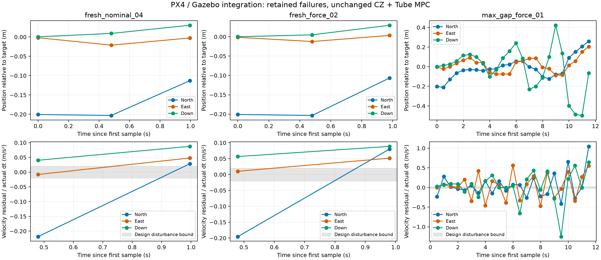

# 当前CZ + Tube MPC的首次Gazebo验证（2026-11-04）

**结论：算法已接入PX4/Gazebo并实际施加控制，但现有数学基线未通过本轮SITL验证。** 无外力时也出现估计集合失去真值包含及空后验；失测叠加场景随后出现垂直速度越界。不能将此前双积分模型中的鲁棒保证延伸至这个物理执行链。

**后续诊断更新：** 原数据保留；逐轴重放确认三次连续位置场景的 k=2 空后验由垂直轴触发。另完成两次独立启动的接口辨识/留出飞行，初步观察到水平响应滞后与垂直增益失配；尚未修复原闭环。见[接口辨识与失败定位](INTERFACE_IDENTIFICATION_RESULTS.md)。

## 1. 实际运行的系统

- 本机Ubuntu WSL2，PX4 v1.17.0 / `d6f12ad1c4f70ad3230afd7d86e971421e02fef4`，Gazebo Harmonic Sim 8.15.0，原始X500刚体/电机模型与默认PX4内环、EKF。
- 正式场景使用此前已验收的`launch-px4.sh x500 headless`，不是简化Python plant。正常解锁、自动起飞、Offboard接管，结束时请求正常降落并确认上锁。
- 当前`finite_memory.py`和`tube_mpc.py`未修改。T=0.5 s，a=0.02，位置噪声界0.005，M=L=1，原增益、Tube、终端、|p|≤3、|v|≤2、|u|≤4保留。
- 外环使用Gazebo SceneBroadcaster的模型世界位姿，ENU转NED，添加冻结种子的有界位置噪声，再施加外环缺测/延迟。PX4内部EKF数据不丢弃。速度来自位姿差分，仅用于理想化初始先验和验证，初始化之后不反馈给估计器/控制器。
- 相对悬停位置设置北向0.2 m调节目标。MAVLink `SET_POSITION_TARGET_LOCAL_NED`只启用acceleration与yaw字段，代码目标为20 Hz保持、2 Hz外环。实际采样间隔及ULog接收证据单独保存，不能以目标频率冒充严格实时保证。
- 外力场景通过Gazebo ApplyLinkWrench发送世界东向0.02 N持续力请求，4秒后或提前停止时清除。该力远小于当前输入限幅；实际总模型误差还包括内环、姿态/推力转换、采样和命令时延。

完整试验约定与调试修订见[预登记](CZ_SITL_PLAN.md)。

## 2. 第一批三场景结果

| 场景 | 首次包含失败 | 最终停止 | 运行至停止的采样时长 | PX4结果 |
|---|---|---|---|---|
| 连续位置，无外力 `fresh_nominal_04` | k=1，约0.48 s | k=2，CZ空后验 | 0.996 s | 正常降落、上锁 |
| 连续位置，0.02 N力请求 `fresh_force_01` | k=1，约0.48 s | k=2，CZ空后验 | 0.980 s | 正常降落、上锁 |
| 最大间隔/延迟，0.02 N力请求 `max_gap_force_01` | k=1，约0.48 s | k=23，速度约束越界 | 11.488 s | 正常降落、上锁 |

表中k从0计数，时长从首次算法采样计。三组均未达到计划的40周期完整运行。

失测组在k=5首次离开跟踪Tube。k=23的垂直参考速度为**2.11178 m/s**，超过2 m/s约束；这时最大位置偏移仍不足0.5 m，整个已计算输入序列的最大绝对值为3.89829，低于4。因此本次终止是**速度约束失效**，不是输入饱和。最后一步候选命令在检查失败后没有发送：ULog只匹配到此前23条命令。

连续位置两组分别只有2条实际算法命令。两组的真值包含失败发生时，较宽的统一估计误差界及Tube仍可暂时容纳实际误差；不能用“暂未离开Tube”掩盖估计后验本身已经不可靠。

第一批外力场景保留发送路径和参数，但没有在发出瞬间存储subscriber握手状态；一次额外CLI查询发生在进程已退出后，返回无发布/订阅者，不能用它证明此前力传输失败或成功。因此另加仅记录握手与发布返回值的重复运行，结果见后续补充；不将第一批两组当作已校准的物理受力对照。

**重复核验 `fresh_force_02`：** `force_subscriber_connected=true`、`force_publish_accepted=true`；实际发送2条算法命令，在k=2再次出现CZ空后验，正常降落上锁。它确认外力发送链路有Gazebo订阅端且接受发布，但不是力传感器实测标定。本轮共4次正式算法接入、3类条件；重复运行初始悬停状态有差异，只能作为接入失效的重复观察，不能据此估计小外力的因果效应。

## 3. 残差证据：现有0.02界不覆盖接入误差

对于无外力试验的首个区间，实际采样间隔0.48 s。按实际间隔而非假定0.5 s重算：

- 北向速度残差等效加速度约 **−0.21861 m/s²**，绝对值约为设计界的10.9倍。
- 北向位置残差等效加速度约 **−0.34198 m/s²**。
- 两者并不相等，表明不能只调整一个常值Bw的幅值就认为位置与速度残差合同闭合。

这里“等效加速度”是一步运动残差诊断，包含飞控响应、命令延迟、非零计算时间、非理想保持以及位姿差分误差，**不是风加速度的独立测量**。首次间隔0.48 s与后续0.496–0.516 s附近抖动也说明严格固定T的合同尚需工程实现。实际dt重算仍明显超界，因此采样间隔偏差不是足够的单一解释。

ULog中逐条匹配算法输出与`trajectory_setpoint.acceleration`，同时确认position/velocity字段为NaN。第一批无外力及小外力试验均匹配到2条已发命令，失测组匹配到23条。这排除了“实际仍在位置参考模式”这一解释，但不等于加速度无滞后实现。



图中灰带为±0.02设计界，曲线保留所有失败点。各场景横轴长度不同；未将提前停止后的轨迹外推。参考速度为约20 ms间隔的位姿差分，不是经过严格误差认证的速度传感器。

图中同条件重复试验展示最后一次，完整四次结果都保留在summary.json及各自目录中。

## 4. 本轮能得出和不能得出的结论

1. 已实际完成“Gazebo物理运动→位置测量→CZ→Tube MPC→PX4加速度路径→物理运动”的接入。
2. 当前未辨识的理想ZOH模型与误差界不适用于直接宣称这条执行链的鲁棒保证；无外扰失败已经足以暴露这个缺口。
3. 最大间隔下，窗口可能只有两个端点量测，缺少额外一致性约束；后验非空不意味着真值仍被包含。失测组能运行更久不代表更抗扰。
4. 本轮没有普通MPC/其他鲁棒控制器对照，不能据此判断CZ+MPC的相对优劣，也没有完成真实抗风能力评估。
5. 监督器的停止、清除力和PX4降落是工程处理，不是当前算法已经证明的安全回退。速度越界之后才终止的事实保留。

## 5. 调试、测试及来源

- `fresh_nominal_01`：独立启动目录错误，PX4没有进入仿真飞行；随后修正etc根路径。
- `fresh_nominal_02`：进入Offboard并计算首条控制，NumPy布尔值无法JSON序列化导致停止；正常降落。细粒度JSON未成功保存，不能计入完整验证数据。
- `fresh_nominal_03`：独立加载加装OdometryPublisher模型时未正常升高；ULog显示飞控请求有效，但物理运动未达目标。保留原始数据，具体插件/初始化原因未确证。正式场景改用原始已验收启动链，而不是修改算法掩盖问题。
- 活动32项数学测试在WSL环境通过，4项接入测试检查坐标变换、模型筛选、MAVLink掩码与JSON布尔类型；测试日志保留。算法源码哈希与本地当前版本一致。
- 环境新增SciPy 1.17.1、OSQP 1.1.3等依赖，未替换PX4固件或模型参数；Python/依赖清单见[环境记录](../../experiments/results/gazebo_cz/environment.txt)。
- 布尔类型、启动目录修复只影响接入层。后续增加握手与“命令已发送”记录也不改变控制决策。

PX4字段映射以本机固定版本`src/modules/mavlink/mavlink_receiver.cpp`核查。Gazebo外力接口参考[ApplyLinkWrench源码](https://github.com/gazebosim/gz-sim/blob/gz-sim8/src/systems/apply_link_wrench/ApplyLinkWrench.cc)，原诊断插件语义参考[OdometryPublisher源码](https://github.com/gazebosim/gz-sim/blob/gz-sim8/src/systems/odometry_publisher/OdometryPublisher.cc)。实验组织与绘图使用本地experimental-design、matplotlib技能，方法工具来源为Kassis, T., Agarwal, V., He, Y., Patel, D., & Brueckner, A. M. (2026), [Scientific Agent Skills](https://arxiv.org/abs/2609.00065)；本轮核对了arXiv元数据，该来源不作为本项目控制理论证据。

## 6. 下一步应先修什么

先固定接管状态与时间同步，记录实际命令接收/保持时刻；辨识加速度接口的内环动态、HTE影响和命令延迟。然后用一般位置/速度残差或含执行滞后状态的预测模型重建估计误差界、Tube及终端。不能直接把实测最大残差当作确定性界；当前统一Tube默认正预算上界约0.0462，也远小于本次首步0.219量级诊断残差，简单放大a可能首先耗尽输入预算。

在新的合同固定后，先重新完成无外扰闭环，再进行同初始条件的无力/力、连续测量/失测成对对照。

## 7. 复现入口

在没有其他PX4实例时，从Windows运行（name必须使用新的目录名，避免覆盖旧数据）：

```powershell
wsl -d Ubuntu -- /home/alfred/px4-research/.venv/bin/python /mnt/d/WorkSpace/AcademicReaserch/scripts/simulation/cz_sitl.py --name fresh_new
wsl -d Ubuntu -- /home/alfred/px4-research/.venv/bin/python /mnt/d/WorkSpace/AcademicReaserch/scripts/simulation/cz_sitl.py --name force_new --force 0.02
wsl -d Ubuntu -- /home/alfred/px4-research/.venv/bin/python /mnt/d/WorkSpace/AcademicReaserch/scripts/simulation/cz_sitl.py --name gap_new --delivery max_gap --force 0.02
```

- [接入程序](../../scripts/simulation/cz_sitl.py)、[审计和绘图程序](../../scripts/simulation/analyze_cz_sitl.py)。
- [汇总数据](../../experiments/results/gazebo_cz/summary.json)。每个场景目录保存算法逐步数据、Gazebo位姿、MAVLink遥测、事件、控制台日志、report/audit；正式场景另保存ULog副本。
- [无外扰审计](../../experiments/results/gazebo_cz/fresh_nominal_04/audit.json)、[力请求审计](../../experiments/results/gazebo_cz/fresh_force_01/audit.json)、[失测叠加审计](../../experiments/results/gazebo_cz/max_gap_force_01/audit.json)。
