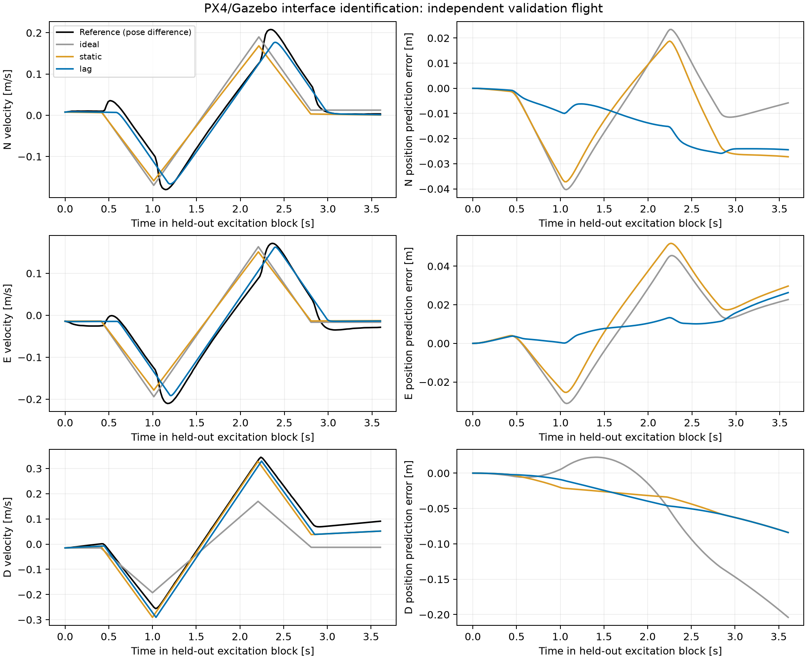

# 加速度接口辨识与失败日志重放（2026-11-04）

**本轮完成了失败定位和初步接口辨识，原 CZ + Tube MPC 尚未通过 Gazebo 验证。** 两次新增辨识飞行完成全部激励并正常降落；它们是开环接口实验，不是新控制器闭环验收。原估计器、MPC 增益、Tube、终端及 PX4 控制参数未改。

最直接的新发现是：此前三次连续位置试验在 k=2 的空后验均由**垂直轴**触发。北向 k=1 已失去真值包含，但其有限窗后验在 k=2 仍非空。不能把“误差最大轴”和“导致停止的轴”混为一谈。

## 1. 旧日志给出的排除与定位

四个旧正式场景均已用原始输入、时间戳位置包和初始化重放原 `FiniteMemoryEstimator`。逐轴首次包含失败与空后验记录在 [old_log_audit.json](../../experiments/results/interface_identification/old_log_audit.json)。

固定 T 下，前三个位置样本必须满足：

\[
\left|y_2-2y_1+y_0-\tfrac12T^2(u_0+u_1)\right|
\le T^2 a+4n=0.025\ \mathrm m.
\]

该条件消去了初始位置与速度，直接检验三包位置、两条已知命令与扰动/测量界的一致性。

| 旧连续位置场景 | 垂直残差绝对值（m） | 允许值（m） | 实际 dt 修正后的残差 / 允许值（m） |
|---|---:|---:|---:|
| fresh_nominal_04 | 0.029344 | 0.025000 | 0.028943 / 0.025889 |
| fresh_force_01 | 0.029061 | 0.025000 | 0.028778 / 0.025317 |
| fresh_force_02 | 0.031554 | 0.025000 | 0.031545 / 0.025317 |

三次均在垂直轴违反必要条件；使用实际间隔仍未恢复相容。M=L=1 稀疏组的有限窗在保存的整个轨迹上均未出现空后验，但三个轴先后失去真值包含，复现了“非空不代表可靠”的问题。

另用**带初始先验的全历史 LP**求最小相容加速度界。无外力场景到 k=2 的北向值为：固定 T 0.20872、实际 dt 0.19686、实际 dt 加首采样真值初值 0.20108 m/s²。最后一种是理想化诊断。这说明采样/初始化修正不足以恢复原 0.02 合同；全历史 LP 比原有限窗保留更多约束，因此它的北向不相容与有限窗非空并不矛盾。

ULog 的 `vehicle_local_position_groundtruth` 与原参考在同一仿真时钟下高度吻合。但 PX4 `GZBridge.cpp:563` 附近明确用同一位姿作差分，**不是独立真速度传感器**；本轮没有消除参考差分的不确定性。旧无力接管时参考速度约 [-0.024,-0.094,0.023] m/s，roll≈1.33°、真实 yaw≈−5.43°，不是完全静止。yaw 的数值本身不能证明接管故障，航向估计与真值可能有偏差。

## 2. 两次新增飞行

按 [预登记计划](INTERFACE_IDENTIFICATION_PLAN.md)，原始 X500、默认 PX4 v1.17.0、无外力、位置保持恢复后再进入 acceleration-only。每块前连续 1.5 秒满足速度、位置、倾角与姿态变化门限。未以真值速度构造激励期间的控制反馈。

| 飞行 | 用途 | 已完成激励块 | 幅值 | 激励阶段三轴最大绝对速度（m/s） | 正常降落/上锁 |
|---|---|---:|---:|---|---|
| interface_calibration_01 | 拟合，三轴正反各一块 | 6/6 | 0.4 m/s² | 0.366 / 0.375 / 0.600 | 是 |
| interface_validation_01 | 独立启动留出验证 | 3/3 | 0.3 m/s² | 0.208 / 0.210 / 0.345 | 是 |

最大相对锚点位移分别为 [0.262,0.260,0.367] m 和 [0.102,0.089,0.289] m，未触发实验监督界。无外力飞行不能证明抗风或缺测鲁棒性。

新增发送日志与临时高频 ULog。实际命令记录中位间隔 52 ms，最大校准/验证间隔分别 60/56 ms。命令切换接收时间戳减去发送时最近位姿时间落在 0–12 ms；该差包含参考样本年龄，**不能直接称单向网络延迟**。此前 200 ms 的日志抽样限制已在新试验中消除，但并未实现严格固定采样证明。

每次结束均恢复原日志配置。完整 `flight.ulg`、位姿、每次发送、阶段、门限、展开序列、控制台及报告保存在对应 `experiments/results/gazebo_cz/interface_*_01/` 目录。

## 3. 候选模型与独立验证

比较理想双积分、静态增益/偏置，以及一阶滞后加有效延迟：

\[
\dot p=v,\qquad\dot v=a_e,\qquad
\tau\dot a_e=-a_e+g u(t-d)+b.
\]

τ=0 时退化为带延迟的静态映射。使用实际 ULog acceleration-only 命令；位置保持数据不参与拟合。按校准集整段速度残差选择 τ∈{0,0.02,…,0.80} s、d∈{0,0.02,…,0.20} s，给定二者以最小二乘拟合 g,b。4 ms 内部积分、20 ms 取样计分；插值不是新增独立观测。完整块只初始化一次，0.5 秒诊断窗口则每窗用参考 p,v 和差分加速度初始化。

留出数据分析前已保存 [校准参数快照](../../experiments/results/interface_identification/calibration_fit_frozen.json)，最终分析逐项复核完全一致。

| 轴 | g | b（m/s²） | τ（s） | d（s） |
|---|---:|---:|---:|---:|
| 北 N | 1.0121 | −0.00346 | 0.04 | 0.16 |
| 东 E | 1.0097 | 0.00106 | 0.02 | 0.18 |
| 下 D | 1.6525 | 0.01740 | 0 | 0.04 |

水平总响应尺度约 0.2 s；多个 τ/d 组合可能接近，不能把所选参数分解直接认作电机时间常数与通信延迟。垂直静态候选增益也约 1.6488，说明单位增益失配不是仅靠增加延迟得到的拟合结果。HTE 随校准块约从 0.7252 升至 0.7278，未隔离其漂移与垂直偏置的因果关系；推力映射斜率、姿态/执行动态仍待单独核验。

以下为留出飞行全部三个块、各轴的 **0.5 秒预测诊断**，不是轨迹跟踪成绩，也不是抗扰性能指标：

| 轴 | 理想→候选速度 RMSE（m/s） | 候选速度最大误差（m/s） | 候选位置最大误差（m） |
|---|---:|---:|---:|
| N | 0.04535 → 0.01110 | 0.02679 | 0.01185 |
| E | 0.04797 → 0.01036 | 0.02508 | 0.01224 |
| D | 0.03859 → 0.01107 | 0.02008 | 0.00512 |

短窗速度 RMSE 下降约 75.5%、78.4%、71.3%，支持将执行动态纳入模型。但**整段漂移尚未解决**：北向整段位置 RMSE 从理想模型的 0.0180 m 变为 0.0234 m，反而变差；垂直整段位置最大预测误差仍为 0.223 m。不能只选择改善指标宣布成功。



图逐轴展示该轴受激励的留出块，表格则汇总三个留出块，包括非激励轴响应。完整分轴模型比较与参数候选见 [model_comparison.json](../../experiments/results/interface_identification/model_comparison.json)，逐点预测见 [predictions.csv](../../experiments/results/interface_identification/predictions.csv)。

## 4. 原估计器在新数据上仍失败

以 T=0.5 s 抽样留出位置，添加固定种子的 ±0.005 m 噪声，并用理想参考初值重放原估计器。因为脉冲切换不全部落在 0.5 s 网格上，先精确积分已记录命令的速度增量与位置一阶矩，将位置变换为

\[
p'_k=p_k-\sum_{j<k}\left[\Delta p_{u,j}-\tfrac{T}{2}\Delta v_{u,j}\right],
\quad \bar u_j=\Delta v_{u,j}/T.
\]

这消去已知输入保持形状造成的位置偏移，保留未知动力学残差；不是简单拿平均输入冒充精确 ZOH。它是离线坐标补偿诊断，没有修改在线算法。

- 北向激励块：N 在 k=1 失去包含、k=3 空后验；D 在 k=1 失去包含、k=2 空后验。
- 垂直激励块：D 在 k=1 失去包含、k=4 空后验。
- 东向激励块：E 在 k=1 失去包含、k=2 空后验；N 在 k=5 失去包含。

稳定悬停、精确已知输入矩修正后仍出现这些失败，因此单靠修启动时序不能完成原模型合同闭合。新辨识模型尚未接入 CZ 或 Tube MPC。

## 5. 下一步及验收

1. 优先处理垂直增益与随时间变化的偏置，同时用水平执行状态/输入历史表示响应滞后。先固定候选离散模型和可观测性；不要把某次拟合的 1.65 当成全工况常数。
2. 用增加的零输入段、反向与不同幅值、独立重复启动检验垂直漂移、跨轴耦合及 τ/d 可辨识性。明确位置/速度参考误差与命令时间不确定性，以一般 G W 或增广模型表达，不直接把数据最大值当确定性扰动界。
3. 冻结新合同后重建估计器、E、Tube、输入收紧与终端。当前候选的最大一步残差已经不能直接复用 a=0.02 的旧管；不能仅修改增益后套用原证明。
4. 先通过无外力闭环的真值包含、硬约束与可行性，再做同初值的外力/缺测成对实验。最终验收仍以扰动承受范围、约束满足、恢复和鲁棒可行域为主，跟踪 RMSE 为辅助。

## 6. 复现与检查

新运行必须使用新 name，不能覆盖原证据：

```powershell
wsl -d Ubuntu -- /home/alfred/px4-research/.venv/bin/python /mnt/d/WorkSpace/AcademicReaserch/scripts/simulation/identify_acceleration.py --name NEW_calibration --split calibration
wsl -d Ubuntu -- /home/alfred/px4-research/.venv/bin/python /mnt/d/WorkSpace/AcademicReaserch/scripts/simulation/identify_acceleration.py --name NEW_validation --split validation
wsl -d Ubuntu -- /home/alfred/px4-research/.venv/bin/python /mnt/d/WorkSpace/AcademicReaserch/scripts/simulation/analyze_acceleration.py --calibration interface_calibration_01 --validation interface_validation_01
wsl -d Ubuntu -- /home/alfred/px4-research/.venv/bin/python /mnt/d/WorkSpace/AcademicReaserch/scripts/simulation/audit_cz_interface.py
```

新增 7 项检查通过：平衡脉冲、校准/验证分离、解析一阶阶跃解、变化输入一阶矩、最小扰动 LP、延迟包时间戳和空后验识别回归。见 [测试日志](../../experiments/results/interface_identification/tests.log)。绘图为二维图；测试进程出现系统/venv Matplotlib 的 Axes3D 导入提示，不影响这些二维产物。两个算法文件 SHA256 与原正式飞行一致。

本轮使用此前采用的实验设计、系统诊断和 Matplotlib 工作流；没有另行检索文献或改动控制理论。来源是本地固定 PX4 提交、实际新旧飞行数据及可复算脚本；输入与分析源码哈希见 [provenance.json](../../experiments/results/interface_identification/provenance.json)。只有两次新增飞行，块内重复样本不能当成独立飞行重复；尚无物理鲁棒性证书、普通 MPC 对照或真实飞行验证。
